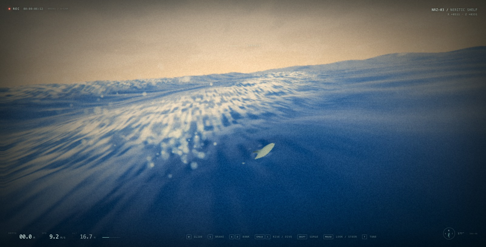

# ocean — a neritic drift

A browser-based dolphin simulator set in an explorable **3 × 3 km neritic shelf**. The point is not a game loop; it is the feeling of a highly agile animal moving through sunlit, silty water.




## Run

```bash
npm install
npm run dev
```

Open the URL Vite prints, click **enter the water**, and use:

| input | action |
| --- | --- |
| `W` | glide / swim forward |
| `S` | brake, then slowly reverse |
| `A` / `D` | bank and carve left / right |
| mouse | free-look and steer with the snout (pointer lock; drag fallback) |
| `Shift` | surge; point the snout up at speed to breach and soar |
| `Space` / `C` | rise / dive |
| arrow up / down | pitch (keyboard fallback) |
| `T` | open the live swim-feel tuning panel |
| `P` | toggle post-processing (raw, grade-free water) |
| `M` | mute / unmute |
| `H` | hide the HUD |

Press `Esc` to release the pointer. Clicking the canvas re-acquires it.

## Tuning

Every feeling number lives in [`src/config.js`](src/config.js) and is exposed live as `window.OCEAN.tuning`. Press `T` for the live panel: sea-state preset and swell/wind parameters (height, wavelength, direction, spread, chop, time scale, whitecaps), hull buoyancy/lung/added-mass/drag/fin/slam/trim parameters, depth-response/shoaling/breaking/aeration/breaker-jet/foam-persistence parameters, advected-foam source/decay, breaker-mist and surf-plume rates, master volume and surf-roar level, wave start time, speed, acceleration, turn response, mouse look, pitch response, pitch self-level, bank intensity, lateral drift, vertical thrust, air control, air lift, air gravity, coast trigger slope, surf carve grip, surf ride depth, surf hold, surf face attitude, surf face lean, surf carve bank, surf wave drive, surf wave pump, surf wave carry, surf glide speed, breach kick, tail beat, acceleration beat, tail stroke, tail heave, acceleration heave, wave travel, wave start, fluke pitch, segment follow, neck/spine bend limits, sand disturbance, sand cut depth, contact cut depth, glide scoop, water scatter, god rays, caustic light, surface haze, sea mist, camera distance, camera height, shoulder and look response, plus the water/debug toggles. Pitch self-level is off by default, so a held look holds its attitude.

### Seeded scenarios

After clicking into the water, the M2 harness is available as `window.OCEAN.scenarios`:

```js
OCEAN.start();                                  // enables input for faceHold
await OCEAN.scenarios.passiveFloat("calm", 5); // scenario 1
OCEAN.scenarios.probeParity(30);               // scenario 2
await OCEAN.scenarios.faceHold("moderate", 4); // scenario 3 live
await OCEAN.scenarios.thrustSaving();          // scenario 3 fixed-pose
await OCEAN.scenarios.shoalingBreak("moderate", 6); // scenario 4
await OCEAN.scenarios.breachCompare("moderate");     // scenario 5
```

Each function moves the animal temporarily and restores its state (the face-hold test holds `W`). The spectrum seed makes the same set/face structure reproducible at a given sim time.

The full debug surface is available as `window.OCEAN` (ocean, seabed, dolphin, camera rig, habitats, particles, renderer, tuner and a `teleport(x,y,z,yaw)` helper).

## What is simulated

- **Dolphin movement** — heading/pitch/roll flight model with angular inertia, automatic bank into the turn, and hull-force translation. Thrust is quick enough for a standing-start burst; the default surge target is **25 m/s** with **18 m/s²** boost acceleration. High-speed surface exits get a tail kick; airborne motion uses **12.5 m/s²** gravity, low lift, snappy vertical drag and snout-led air steering so a fast breach arcs back down instead of hanging. A small near-surface settling force pulls a dry, fast body back into the water when there is no upward intent, so it porpoises instead of skimming above the surface. Steering still commands the snout/attitude directly, while translation is force-driven and can be carried, turned or thrown by the water.
- **Procedural skeletal spine** — the model is a GPU-skinned 9-bone chain. The snout is anchored to the mouse target and the camera orbits from that same look frame, so the view responds immediately while each following segment keeps its own direction, damps toward the segment ahead and is clamped to an anatomical joint cone (`headBendLimit` at the neck, `bodyBendLimit` down the spine). Fixed segment lengths and a torso-to-fluke swimming wave give the body a semi-rigid, fluid trail. The wave's frequency and amplitude follow actual swim speed and acceleration, so a burst of acceleration produces a stronger, faster stroke; the fluke adds a lagging pitch that tracks the same effort.
- **Snout-led camera** — the chase view orbits from the same yaw/pitch target that drives the snout, with light smoothing rather than physics-body lag. The body, velocity and spine still trail behind, but the view, compass and aim lead with the animal's head.
- **Waves** — a seeded, two-train directional spectrum: a JONSWAP swell (96 components, default **13.5 m Hs / 320 m peak**, with a broader directional and wavelength spread) plus a **1.1 m cross-sea** (32 components, 46 m, offset ~54°). Both are explicit Gerstner sums with one shared deterministic clock. The exact component arrays are uploaded to the vertex shader and evaluated by `src/water/field.js` on the CPU, so `OCEAN.water.sampleHeight()` / `sampleWater()` and the rendered GPU patch agree to **mean 0.01 cm / max 0.04 cm** in the parity probe (a shader-side horizontal-displacement bug was found and fixed in M2). The surface is a camera-following radial clipmap out to 7 km; fragment shading adds three non-commensurate procedural ripple cascades (53 m, 17 m, 5.7 m), distance normal filtering, Schlick Fresnel with the existing sky palette, sun glitter, depth absorption from the bathymetry map, crest transmission and whitecaps derived from local slope, crest height and Jacobian compression. Seen from below, the underside splits into a critical-angle Snell window and total internal reflection with a turquoise rim; the full Snell/caustic pass is M5 work.
- **Depth response, shoaling and breaking (M3; big-wave arena)** — a shared 256² bathymetry field (baked from the same `seabedHeight()` used by the sand, reef and floor collision) drives finite-depth dispersion (`k/k0 = 1/sqrt(tanh(k0 h))`), Green's-law shoaling (`H ∝ h^-1/4`), local phase speed and a refraction-like phase gradient through the local wavenumber. The default arena is a **curved peak-and-shoulder reef at (450, 300)** aligned across the swell: a ~38 m seaward basin shoals onto a ~14–20 m crest, with a controlled deep floor so the big-wave troughs cannot expose sand. The **13.5 m Hs, 320 m** swell breaks into a broad, peeling face of roughly **20 m** instead of one continuous vertical wall. A 3.8 m shallow peak at `sAlong ≈ −35 m`, a 2.2 m deeper shoulder to one side, a bowed break line (`sin(sAlong/190)`) and a cross-sea break the crest into sections and soften the face. Breaking is triggered by `Hs_local / h` (default ratio **0.9**, softness ±0.10), with an Iribarren classification from the local bed slope (spilling <0.5, plunging 0.5–3.3, surging >3.3). The heightfield cannot overhang, so the plunging lip is a small forward-shifted crest bump (`breakerLip` **0.12**), a dark tube band and a foam tongue; there is no amplitude-focus multiplier and no vertex fold. The velocity field gets a crest-gated breaker jet, and aeration is gated by the crest so the animal is not pulled down in the trough. Foam streaks run down the upper face, and a dark band under the lip reads as the tube opening. The deterministic finite-depth spectral model keeps CPU and GPU on exactly the same field, has no window seams or readback latency, and runs at 60 fps; the trade-off is that it is not a nonlinear solver and is documented as an approximation.
- **Hull hydrodynamics / emergent surfing (M2)** — a 170-panel surface of revolution (15 stations × 10 radial panels + end caps) is matched to a displaced volume of **0.58 m³**, giving a **595 kg** animal at neutral density. Forces are integrated at 120 Hz (two substeps) from hydrostatic pressure, wave dynamic pressure (Froude–Krylov), quadratic normal and skin-friction drag relative to the local water velocity, an extra slam coefficient while panels first immerse, and pectoral/fluke lift. Effective mass is anisotropic (added mass: 0.1 forward / 1.0 lateral / 1.0 vertical). Lung buoyancy is positive near the surface, decays with depth and fades with speed, so a passive animal floats and bobs while a cruising animal is neutral at 5–6 m depth. The wave kinematics are refreshed once per frame and reused for the two force substeps to keep the CPU under budget. On a 19° deep-water face at 9.5 m/s the wave field supplied **2.77 m/s²** (M2 measurement); with depth response on a 19° shoaling face it supplies **1.29 m/s²**, about **40%** of the 3.23 m/s² cruise thrust, and a matched-wet flat-water comparison required **4.46 m/s²**.
- **Soft surf contact and carve grip (post-M8)** — on a steep face at speed the animal attaches to the local surface plane at a planing waterline. A normal spring, a damped surface-follow and a soft ceiling hold it at depth and track the face as it rises or falls; crest pressure can no longer throw a light, half-wet hull into a hover unless the player boosts. The ridden line blends the player's heading with the local wave travel (`surf wave carry`), scaled down when the player deliberately points down the face, so a natural across/up line stays with the moving face instead of being left behind. Tangential momentum is rotated toward that line (`surf carve grip`) with speed mostly preserved and a small rail bite. Attitude follows the face: the visible spine blends from the snout-led mouse target onto the physical face pitch (`poseBlend`), pitch tracks the slope along the nose, and roll combines the cross-face normal, the player's carve bank and the face lean. The contact releases on a flat crest, `Space`/`C`, speed below ~3.5 m/s, a boosted launch, or leaving the face. The debug **SURF** line reports **contact**, plus the local slope, phase speed, carry, line speed and pump.
- **Porpoise ↔ coast state (post-M8)** — the tail stroke is a continuous blend, not a mode switch. The state is classified from the **velocity along the slope**, not from the blended nose: climbing (or boosting/braking/pitching) targets full **active porpoising** with tail undulation and thrust, while a descending run fades `strokeAmount` toward zero and reports **coast**; tail heave, fluke pitch, phase advance and active thrust all scale with it. A wave-energy pump along the line targets the local phase speed, so a zero-stroke coast carries speed rather than stalling. In the dedicated coast capture the animal held **77% contact** (releasing as the face flattened), faded the stroke to **0.01**, and ran **13.6 → 12.6 m/s** down the face. A separate climbing ride held **100% contact** at **10.7 m/s mean / 11.8 m/s max** against a **12.3 m/s** phase speed with the body roll at only **0.08–0.09 rad**; an earlier 70° auto-bank bug came from the wave-carry yaw being counted as a carve turn, which is now excluded.
- **Dolphin→water effects (M4)** — a separate foam layer (1000 CPU-advected point sprites) adds a speed-scaled wake trail, bow wave, tail boil and tail-slap spray while the body is within ~2 m of the surface (strong at 0.3 m, invisible by 2 m). The GPU contact heightfield receives bow/tail splats, so the surface parts around the moving body. Exit events spawn a body-shaped spray sheet and ballistic droplets; re-entry spawns a ring crown, cavity/ring impulse, bubble plume and persistent foam, with event debouncing so surface skimming does not saturate the effect budget. Every new particle samples the local wave velocity at spawn and carries it, then blends with the ambient current. A tail slap triggers when the fluke actually crosses the surface downward, not on a fixed animation phase.
- **Waterline and underwater rendering (M5)** — the surface chooses above/below shading per fragment, but blends in the global camera state when clearly above or below so distant tilted wave planes cannot fake an underside. Near the waterline it uses the local vertical side, enabling true half-in/half-out frames; the camera is allowed to sit in a narrow surface band and the surface gets a thin meniscus line. A lacy meniscus collar hugs the dolphin using a body-centred ring uniform, and close-range sun glitter is suppressed in a small radius around the body so the animal stays readable against the face. Underwater, the surface computes a physical Snell window: refracted sky inside the 48.6° critical angle, total internal reflection outside, a sharp turquoise rim, wave-shape shading, sun glitter and caustic veins. The camera-following underwater view keeps the scene shafts/caustics and particulates; the volumetric pass was strengthened for M5.
- **Advected surf foam (post-M5)** — a 128², 400 m foam/aeration scalar over the surf ridge is advanced at 15 Hz with semi-Lagrangian advection by the peak orbital velocity, an onshore drift, cross-wave swirl and a small diffusion pass, then exponential decay. It is sourced only across the break-onset band (`breakMask ≈ 0.5`) where the analytic whitewater is transitioning, so foam persists and drifts onshore after each crest instead of switching off with the spectral phase. The field uploads as an 8-bit `DataTexture` sampled by the ocean vertex shader and is queried bilinearly by `ocean.sampleWater()`/`sampleWaterBatch()`, so visible foam contributes up to 0.5 aeration to hull buoyancy and thrust. At render time the field is thresholded through the existing foam/lace noise, so it keeps blue gaps and reads as whitewater rather than a uniform cream sheet. It is visual/physics aeration only: it never moves the surface height, which remains the analytic M3 profile. Toggle **advected foam**, with **foam source** and **foam decay** controls in T. The update averages well under 0.1 ms per rendered frame at 15 Hz.
- **Cooler grazing-sky reflection (post-M6)** — the surface reflects a muted zenith/horizon mix instead of the warm sky dome, using a broad low-altitude transition. Small wave-normal changes no longer swing the reflection between peach horizon and blue zenith, which removes the busy cream patchwork that was most visible from 15–20 m above the water. The sky dome keeps its golden horizon; sun glints and reflected cloud bands are unchanged.
- **Breaker mist (post-M6)** — a dedicated 320-particle mist system spawns from foam-rich cells along the break line, lifted and carried onshore by the local surface velocity and wave direction. It is separate from the dolphin splash pool, so a breach cannot starve the ambient surf, and it fades out beyond 160 m from the bank. **surf spray** and **surf spray rate** are in T (default on, 30 spawns/s); the effect costs ~0.1–0.2 ms of the effects layer.
- **Subsurface surf plume (post-M6)** — while the camera is underwater, a directed cone in front of the view samples foam-rich break cells and emits ring bubbles plus large low-alpha aeration puffs. The bubbles and haze are advected by the local water, capped within 160 m of the bank, and kept separate from dolphin bubble/splash stats. **surf plume** and **surf plume rate** are in T (default on, 20 bursts/s); the same ~0.1–0.2 ms effects budget covers it.
- **Surf roar (post-M6)** — a filtered-noise breaker layer tracks the distance to the surf ridge at (450, 300) (full level inside ~70 m, silent by ~320 m), with a slow set rhythm and periodic crash swells. It opens to a ~620 Hz roar above water and closes to a low-passed ~190 Hz rumble underwater, and is stereo-panned toward the bank's bearing. The crash noise buffer is generated once during loading. **master volume** and **surf roar** level are in T.
- **Experimental surf-zone solver (off by default)** — `src/water/solver.js` is a fixed 192 m, 128² nonlinear shallow-water solver with Lax-Friedrichs fluxes, open-boundary forcing from the spectral field, a sponge, a slope limiter and a persistent advected foam scalar. It is exposed as **surf-zone solver** in T, but defaults **off**: its numerical diffusion and boundary forcing still make it visibly flatter/paler than the analytic M3 surf, so the proven spectral surf ridge remains the default. It is kept as a working prototype for the next solver iteration.
- **Dynamic surface heightfield** — a small GPU wave-equation pass in ping-pong render targets. Contact impulses from the dolphin's nose, body and fluke displace the local surface and create foam/wake. It is a visual contact field layered on top of the authoritative spectrum; the physics query deliberately excludes it.

- **Water debug tools** — the `T` panel exposes the sea-state presets and all wave parameters, plus a probe marker locked to the CPU surface with a phase-speed/crest-normal arrow, GPU parity readback, crest-line and slope overlays, foam/aeration tint, and a readout of local height, face angle, phase speed and dolphin speed / phase speed. `P` removes the film grade, bloom, volumetric haze and composer downsampling for judging the water; the raw path still applies the standard tone-map and sRGB output transform.
- **Reference coral reef** — the opening patch reef uses photogrammetry specimens from the NMNH coral collection: *Corallium* sp., *Diploria labyrinthiformis*, *Distichopora borealis* and *Stylaster sanguineus*. They sit on the sand with soft contact shadows, caustics and a hand-cleared seagrass halo, surrounded by procedural far-field reef.
- **Procedural branching coral** — the non-scan reef coral is now a smooth, tapered, continuously curved branching colony rather than low-radial cylinders. It uses knobby cross-sections, random asymmetric growth, side branchlets, rounded holdfasts and tips. Physical-scale tube UVs map a 512² generated corallite surface with large pale cups, dark centres, radial septa, algae films, a matching normal map, bump detail and an emissive polyp-rim mask, so the texture survives the low-fi grade instead of dissolving into a smooth silhouette.
- **Granular seabed** — a 384² CPU heightfield over a 120 m moving patch, displaced through a one-channel floating-point texture into a matching 384-segment near mesh (~31 cm cells). The deformable layer works over a **–3.6 m to +2.0 m** range, with a 1.4 m contact cut cap and a 0.06 m glide scoop. The 30 Hz physical surface is chased every rendered frame by a smoothed visual height field, so contact and slumping read as continuous motion rather than stepped updates. Stamps are volume-conserving; direct nose/belly contact cuts directional trenches, high-speed impacts throw craters and ejecta rims, and fluke contacts use a wider tail-slap crater. Low glides apply two pressure troughs ahead of the body plus a broad wake wash without touching the bed. An eight-neighbour, mass-conserving talus flow relaxes slopes back toward a 30° angle of repose; no global settling is applied. Direct and indirect events feed soft, long-lived silt particles that drift with the local current. Wind ripples, shell hash, pebbles, organic detritus and coral rubble break up the flat sand. When the 120 m near window recenters, its 148k static height/colour/normal vertices are rebuilt in a worker and uploaded on the next frame, so the frequent 34 m camera crossing does not hitch the main thread.
- **Fine-grained vegetation** — Eelgrass tufts use five curved, twisted blades with five segments, a vein/epiphyte/bump texture, mottled blade shading and brown dieback.
- **Benthic life** — Scallops are ribbed, UV-textured and bump-mapped, with visible empty shells scattered through the meadow. The burrowed crab has a mottled carapace, jointed two-segment legs, pincer claws and eyestalks.
- **Hidden objects** — scallop shells and a crab are buried at measured depths in the sand. They appear only when the actual heightfield is lowered by plowing or a tail slap.
- **Depth-aware volumetric light** — the composer keeps a scene depth texture on each read/write buffer and runs a custom pass immediately after the scene. A screen-space march resolves soft sun shafts against real geometry silhouettes, depth-reconstructed normals receive moving caustic filaments, and a depth-scaled scatter/absorption term deepens the water with distance. Above the surface, a separate branch adds warm horizon haze, sea mist and sun halation. The pass runs before bloom and the film grade, so the shafts bloom and grain the same way the scene does.
- **Performance budget** — the reef and seagrass are split into spatial chunks, frustum-culled and faded out at 120 m / 100 m (both beyond readable fog), the composer is capped at roughly 0.6 megapixels, bloom runs at quarter resolution, the shaft march shortens to ten steps and skips when the sun is behind the camera, branch and grass geometry use near-field LODs, and the audio graph is built during the loading card. The perf readout reports **0.75 s rolling averages** per layer; draw calls and triangles accumulate the scene and every composer pass. The recenter worker removes the previous 200-300 ms sand stalls. M5 headless measurements (Metal ANGLE, 1600×900) are **60 fps (16.67 ms, vsync)** with **GPU ~6.7–13.2 ms**, hull/dolphin CPU ~1.7–6.7 ms, ocean ~0.1–0.2 ms, seabed ~0.2–0.4 ms and effects ~0.1 ms. The underwater Snell view is ~8.6 ms, the waterline view ~9.5 ms and the above-water breach ~7.1 ms. M4’s surface-swim measurement with ~240 live foam and ~250 live splash particles was ~7.4 ms GPU and 0.1–0.4 ms effects CPU. A conservative **dynamic quality governor** (toggle in T) steps the composer scale down by 0.05 after sustained >18.5 ms frames, never below `dynamicQualityMinScale` (0.45), with a 2.5 s cooldown so it cannot hunt. CPU/GPU surface parity over 30 random points across ±800 m, including the big-wave ridge, is **mean 1.75 cm, p95 5.2 cm, max 9.8 cm**; in deep water the residual is sub-centimetre, and at zero chop it is 0.1 mm. The water mesh is 56,320 vertices / 112,128 triangles. The final carve build holds **60 fps (16.67 ms)** at 1600×900 with **26 draw calls / 569k triangles**; the 0.75 s averages are dolphin+hull **~2.4 ms**, ocean **~0.4 ms**, seabed **~0.2 ms** and effects **~0.06 ms**.
- **Film look** — a custom 2000s camcorder pass with lens softness, chromatic aberration, highlight halation, grain, chroma smear, quantised channels, macroblock noise, vignette, scanline smear, slow iris hunting, white-balance drift and optional water droplets. The shelf water is vivid blue in open water and green-teal in the shallows, with suspended particulate, moving surface sheen and uneven sunlight.

### Big-wave measurements

Metal ANGLE, 1600×900, render scale 0.6, 0.75 s rolling averages, 60 Hz link.

| viewpoint | frame | GPU | ocean | seabed | dolphin | effects | draws | triangles |
| --- | --- | --- | --- | --- | --- | --- | --- | --- |
| above-water ridge | 16.7 ms | 18–19 ms | 0.38 ms | 0.21 ms | 2.16 ms | 0.04 ms | 25 | 568,976 |
| dolphin on the face | 16.7 ms | 13.9 ms | 0.42 ms | 0.23 ms | 2.16 ms | 0.05 ms | 25 | 568,976 |
| shoaling-break ride | 16.7 ms | 11.8 ms | 0.40 ms | 0.36 ms | 2.27 ms | 0.10 ms | 25 | 568,976 |

The ridge view is intentionally GPU-heavier than the old calm bank because the camera sees the whole peak-and-shoulder face and its foam; the playable chase views sit lower. The GPU timer is noisier than frame pacing: the surf-riding captures hold 60 fps / 16.7 ms with no dropped frames.

## Project layout

```text
src/
  config.js      tuning, palette, control panel map
  main.js        boot, scene assembly, render loop
  dolphin.js     controller, GLB rig, constrained spine, shaders
  ocean.js       water surface, sky, GPU wake heightfield, parity probe
  water/
    spectrum.js  seeded JONSWAP swell + wind-sea component generator
    field.js     CPU-authoritative sampling (height, normal, velocity, pressure)
    shaders.js   shared GLSL vertex shader and one-pixel height probe
    hull.js      170-panel hydrostatics, FK, drag, lift, added mass, slams
    scenarios.js seeded passive-float, parity, face-hold and thrust-saving tests
    bathymetry.js 256² depth map, 60 m range, baked from seabedHeight()
    foam.js      advected surf foam/aeration field shared by shader and hull
    debug.js     probe marker, phase arrow, force overlays and readout
  sand.js        granular seabed simulation, recenter orchestration and sand shaders
  sand-worker.js off-thread static seabed height/colour/normal rebake
  habitat.js     reference corals, patch reefs, seagrass, shells
  particles.js   splash, bubbles, silt and marine snow
  camera.js      snout-led handheld chase camera
  input.js       keyboard / pointer-lock / drag / touch
  hud.js         telemetry, compass, tuner, toasts
  post.js        composer, depth-aware volumetric light and camera-feed film shader
  audio.js       generative WebAudio ambience
```

The dolphin model is `public/dolphin.glb` and is normalized/rolled upright at load. Its geometry is baked into bind space, weighted to a procedural 9-bone spine, and deformed on the GPU.

The reference coral scans and their 2K diffuse/normal/occlusion maps live under `public/corals/`. They are loaded only for the opening reef's hero specimens; the rest of the shelf uses cheaper procedural reef geometry.
