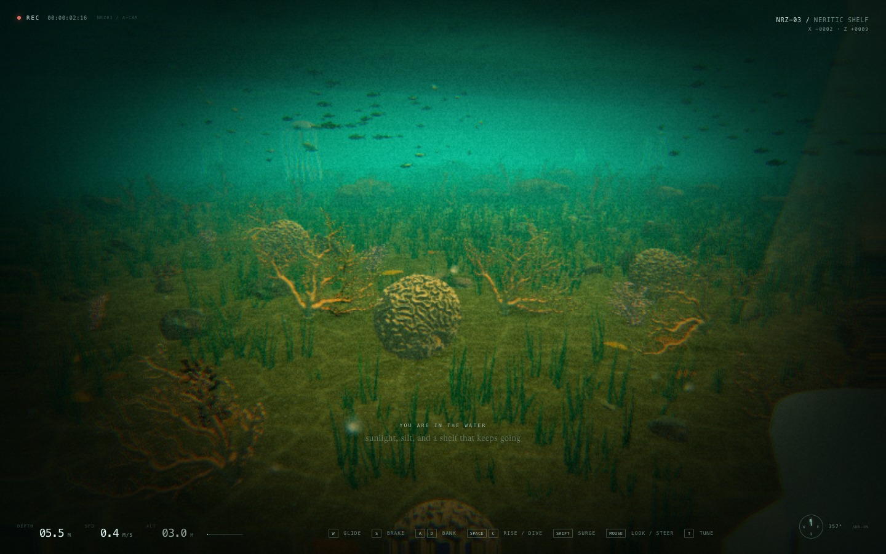
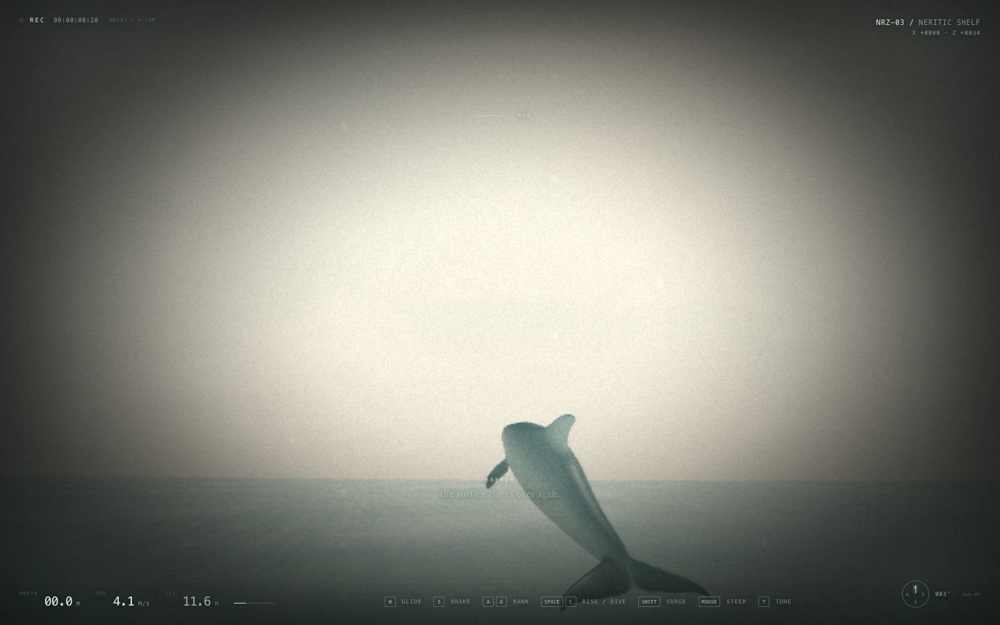

# ocean — a neritic drift

A browser-based dolphin simulator set in an explorable **3 × 3 km neritic shelf**. The point is not a game loop; it is the feeling of a highly agile animal moving through sunlit, silty water.





## Run

```bash
npm install
npm run dev
```

Open the URL Vite prints, click **enter the water**, and use:

| input | action |
| --- | --- |
| `W` | glide / swim forward |
| `S` | brake, then slowly reverse |
| `A` / `D` | bank and carve left / right |
| mouse | free-look and steer with the snout (pointer lock; drag fallback) |
| `Shift` | surge; point the snout up at speed to breach and soar |
| `Space` / `C` | rise / dive |
| arrow up / down | pitch (keyboard fallback) |
| `T` | open the live swim-feel tuning panel |
| `P` | toggle post-processing (raw, grade-free water) |
| `M` | mute / unmute |
| `H` | hide the HUD |

Press `Esc` to release the pointer. Clicking the canvas re-acquires it.

## Tuning

Every feeling number lives in [`src/config.js`](src/config.js) and is exposed live as `window.OCEAN.tuning`. Press `T` for the live panel: sea-state preset and swell/wind parameters (height, wavelength, direction, spread, chop, time scale, whitecaps), hull buoyancy/lung/added-mass/drag/fin/slam/trim parameters, depth-response/shoaling/breaking/aeration/breaker-jet/foam-persistence parameters, speed, acceleration, turn response, mouse look, pitch response, pitch self-level, bank intensity, lateral drift, vertical thrust, air control, air lift, air gravity, breach kick, tail beat, acceleration beat, tail stroke, tail heave, acceleration heave, wave travel, wave start, fluke pitch, segment follow, neck/spine bend limits, sand disturbance, sand cut depth, contact cut depth, glide scoop, water scatter, god rays, caustic light, surface haze, sea mist, camera distance, shoulder and look response, plus the water/debug toggles. Pitch self-level is off by default, so a held look holds its attitude.

### Seeded scenarios

After clicking into the water, the M2 harness is available as `window.OCEAN.scenarios`:

```js
OCEAN.start();                                  // enables input for faceHold
await OCEAN.scenarios.passiveFloat("calm", 5); // scenario 1
OCEAN.scenarios.probeParity(30);               // scenario 2
await OCEAN.scenarios.faceHold("moderate", 4); // scenario 3 live
await OCEAN.scenarios.thrustSaving();          // scenario 3 fixed-pose
await OCEAN.scenarios.shoalingBreak("moderate", 6); // scenario 4
await OCEAN.scenarios.breachCompare("moderate");     // scenario 5
```

Each function moves the animal temporarily and restores its state (the face-hold test holds `W`). The spectrum seed makes the same set/face structure reproducible at a given sim time.

The full debug surface is available as `window.OCEAN` (ocean, seabed, dolphin, camera rig, habitats, particles, renderer, tuner and a `teleport(x,y,z,yaw)` helper).

## What is simulated

- **Dolphin movement** — heading/pitch/roll flight model with angular inertia, automatic bank into the turn, and hull-force translation. Thrust is quick enough for a standing-start burst; high-speed surface exits get a tail kick; airborne motion uses low drag, 9.81 m/s² gravity, speed-dependent body lift and snout-led air steering so a fast breach carries into a long free glide. Steering still commands the snout/attitude directly, while translation is now force-driven and can be carried, turned or thrown by the water.
- **Procedural skeletal spine** — the model is a GPU-skinned 9-bone chain. The snout is anchored to the mouse target and the camera orbits from that same look frame, so the view responds immediately while each following segment keeps its own direction, damps toward the segment ahead and is clamped to an anatomical joint cone (`headBendLimit` at the neck, `bodyBendLimit` down the spine). Fixed segment lengths and a torso-to-fluke swimming wave give the body a semi-rigid, fluid trail. The wave's frequency and amplitude follow actual swim speed and acceleration, so a burst of acceleration produces a stronger, faster stroke; the fluke adds a lagging pitch that tracks the same effort.
- **Snout-led camera** — the chase view orbits from the same yaw/pitch target that drives the snout, with light smoothing rather than physics-body lag. The body, velocity and spine still trail behind, but the view, compass and aim lead with the animal's head.
- **Waves** — a seeded, two-train directional spectrum: a narrow JONSWAP swell (96 components, long crests and visible sets) plus a broader wind sea (32 components, offset direction). Both are explicit Gerstner sums with one shared deterministic clock. The exact component arrays are uploaded to the vertex shader and evaluated by `src/water/field.js` on the CPU, so `OCEAN.water.sampleHeight()` / `sampleWater()` and the rendered GPU patch agree to **mean 0.01 cm / max 0.04 cm** in the parity probe (a shader-side horizontal-displacement bug was found and fixed in M2). The surface is a camera-following radial clipmap out to 7 km; fragment shading adds three non-commensurate procedural ripple cascades (53 m, 17 m, 5.7 m), distance normal filtering, Schlick Fresnel with the existing sky palette, sun glitter, depth absorption from the bathymetry map, crest transmission and whitecaps derived from local slope, crest height and Jacobian compression. Seen from below, the underside splits into a critical-angle Snell window and total internal reflection with a turquoise rim; the full Snell/caustic pass is M5 work.
- **Depth response, shoaling and breaking (M3)** — a shared 256² bathymetry field (baked from the same `seabedHeight()` used by the sand, reef and floor collision) drives finite-depth dispersion (`k/k0 = 1/sqrt(tanh(k0 h))`), Green's-law shoaling (`H ∝ h^-1/4`), local phase speed and a refraction-like phase gradient through the local wavenumber. A broad **surf bank** at (260, 140) rises from ~10 m to ~2.6 m over ~250 m and is the breaking zone. Breaking is triggered by `Hs_local / h` (default ratio **0.85**, softness ±0.12), with an Iribarren classification from the local bed slope (spilling <0.5, plunging 0.5–3.3, surging >3.3). The height field cannot overhang, so the plunging lip is a forward-shifted crest bump plus a foam tongue; the velocity field gets a breaker jet up to ~2.5 m/s. Whitewater is exposed to physics as aeration α (up to 0.85), which lowers effective density, buoyancy and thrust. I chose a deterministic finite-depth spectral model over a moving-window Boussinesq solver in a worker: it keeps CPU and GPU on exactly the same field, has no window seams or readback latency, and runs at 60 fps; the trade-off is that it is not a nonlinear solver and is documented as an approximation.
- **Hull hydrodynamics / emergent surfing (M2)** — a 170-panel surface of revolution (15 stations × 10 radial panels + end caps) is matched to a displaced volume of **0.58 m³**, giving a **595 kg** animal at neutral density. Forces are integrated at 120 Hz (two substeps) from hydrostatic pressure, wave dynamic pressure (Froude–Krylov), quadratic normal and skin-friction drag relative to the local water velocity, an extra slam coefficient while panels first immerse, and pectoral/fluke lift. Effective mass is anisotropic (added mass: 0.1 forward / 1.0 lateral / 1.0 vertical). Lung buoyancy is positive near the surface, decays with depth and fades with speed, so a passive animal floats and bobs while a cruising animal is neutral at 5–6 m depth. The wave kinematics are refreshed once per frame and reused for the two force substeps to keep the CPU under budget. On a 19° deep-water face at 9.5 m/s the wave field supplied **2.77 m/s²** (M2 measurement); with depth response on a 19° shoaling face it supplies **1.29 m/s²**, about **40%** of the 3.23 m/s² cruise thrust, and a matched-wet flat-water comparison required **4.46 m/s²**.
- **Dolphin→water effects (M4)** — a separate foam layer (1000 CPU-advected point sprites) adds a speed-scaled wake trail, bow wave, tail boil and tail-slap spray while the body is within ~2 m of the surface (strong at 0.3 m, invisible by 2 m). The GPU contact heightfield receives bow/tail splats, so the surface parts around the moving body. Exit events spawn a body-shaped spray sheet and ballistic droplets; re-entry spawns a ring crown, cavity/ring impulse, bubble plume and persistent foam, with event debouncing so surface skimming does not saturate the effect budget. Every new particle samples the local wave velocity at spawn and carries it, then blends with the ambient current. A tail slap triggers when the fluke actually crosses the surface downward, not on a fixed animation phase.
- **Waterline and underwater rendering (M5)** — the surface chooses above/below shading per fragment, but blends in the global camera state when clearly above or below so distant tilted wave planes cannot fake an underside. Near the waterline it uses the local vertical side, enabling true half-in/half-out frames; the camera is allowed to sit in a narrow surface band and the surface gets a thin meniscus line. A meniscus/foam collar hugs the dolphin using a body-centred ring uniform. Underwater, the surface computes a physical Snell window: refracted sky inside the 48.6° critical angle, total internal reflection outside, a sharp turquoise rim, wave-shape shading, sun glitter and caustic veins. The camera-following underwater view keeps the scene shafts/caustics and particulates; the volumetric pass was strengthened for M5.
- **Dynamic surface heightfield** — a small GPU wave-equation pass in ping-pong render targets. Contact impulses from the dolphin's nose, body and fluke displace the local surface and create foam/wake. It is a visual contact field layered on top of the authoritative spectrum; the physics query deliberately excludes it.

- **Water debug tools** — the `T` panel exposes the sea-state presets and all wave parameters, plus a probe marker locked to the CPU surface with a phase-speed/crest-normal arrow, GPU parity readback, crest-line and slope overlays, foam/aeration tint, and a readout of local height, face angle, phase speed and dolphin speed / phase speed. `P` removes the film grade, bloom, volumetric haze and composer downsampling for judging the water; the raw path still applies the standard tone-map and sRGB output transform.
- **Reference coral reef** — the opening patch reef uses photogrammetry specimens from the NMNH coral collection: *Corallium* sp., *Diploria labyrinthiformis*, *Distichopora borealis* and *Stylaster sanguineus*. They sit on the sand with soft contact shadows, caustics and a hand-cleared seagrass halo, surrounded by procedural far-field reef.
- **Procedural branching coral** — the non-scan reef coral is now a smooth, tapered, continuously curved branching colony rather than low-radial cylinders. It uses knobby cross-sections, random asymmetric growth, side branchlets, rounded holdfasts and tips. Physical-scale tube UVs map a 512² generated corallite surface with large pale cups, dark centres, radial septa, algae films, a matching normal map, bump detail and an emissive polyp-rim mask, so the texture survives the low-fi grade instead of dissolving into a smooth silhouette.
- **Granular seabed** — a 384² CPU heightfield over a 120 m moving patch, displaced through a one-channel floating-point texture into a matching 384-segment near mesh (~31 cm cells). The deformable layer works over a **–3.6 m to +2.0 m** range, with a 1.4 m contact cut cap and a 0.06 m glide scoop. The 30 Hz physical surface is chased every rendered frame by a smoothed visual height field, so contact and slumping read as continuous motion rather than stepped updates. Stamps are volume-conserving; direct nose/belly contact cuts directional trenches, high-speed impacts throw craters and ejecta rims, and fluke contacts use a wider tail-slap crater. Low glides apply two pressure troughs ahead of the body plus a broad wake wash without touching the bed. An eight-neighbour, mass-conserving talus flow relaxes slopes back toward a 30° angle of repose; no global settling is applied. Direct and indirect events feed soft, long-lived silt particles that drift with the local current. Wind ripples, shell hash, pebbles, organic detritus and coral rubble break up the flat sand. When the 120 m near window recenters, its 148k static height/colour/normal vertices are rebuilt in a worker and uploaded on the next frame, so the frequent 34 m camera crossing does not hitch the main thread.
- **Fine-grained substrate and vegetation** — near rocks use UV-mapped procedural normal detail, pitting and encrusting variation; the opening reef also has smaller high-detail hard-substrate stones. Eelgrass tufts use five curved, twisted blades with five segments, a vein/epiphyte/bump texture, mottled blade shading and brown dieback.
- **Detailed marine life** — schooling fish have shaped bodies, fins, eyes, vertex colouring, scale/gill shading and a shader-driven tail beat. Jellyfish use a high-resolution bell with procedural radial canals and gonads, sixteen animated tentacles and four translucent oral-arm ribbons. Scallops are ribbed, UV-textured and bump-mapped, with visible empty shells scattered through the meadow. The burrowed crab has a mottled carapace, jointed two-segment legs, pincer claws and eyestalks.
- **Hidden objects** — scallop shells and a crab are buried at measured depths in the sand. They appear only when the actual heightfield is lowered by plowing or a tail slap.
- **Depth-aware volumetric light** — the composer keeps a scene depth texture on each read/write buffer and runs a custom pass immediately after the scene. A screen-space march resolves soft sun shafts against real geometry silhouettes, depth-reconstructed normals receive moving caustic filaments, and a depth-scaled scatter/absorption term deepens the water with distance. Above the surface, a separate branch adds warm horizon haze, sea mist and sun halation. The pass runs before bloom and the film grade, so the shafts bloom and grain the same way the scene does.
- **Performance budget** — the reef and seagrass are split into spatial chunks, frustum-culled and faded out at 120 m / 100 m (both beyond readable fog), the composer is capped at roughly 0.6 megapixels, bloom runs at quarter resolution, the shaft march shortens to ten steps and skips when the sun is behind the camera, branch and grass geometry use near-field LODs, and the audio graph is built during the loading card. The recenter worker removes the previous 200-300 ms sand stalls. M5 headless measurements (Metal ANGLE, 1600×900) are **60 fps (16.67 ms, vsync)** with **GPU ~6.7–13.2 ms**, hull/dolphin CPU ~1.7–6.7 ms, ocean ~0.1–0.2 ms, seabed ~0.2–0.4 ms and effects ~0.1 ms. The underwater Snell view is ~8.6 ms, the waterline view ~9.5 ms and the above-water breach ~7.1 ms. M4’s surface-swim measurement with ~240 live foam and ~250 live splash particles was ~7.4 ms GPU and 0.1–0.4 ms effects CPU. A conservative **dynamic quality governor** (toggle in T) steps the composer scale down by 0.05 after sustained >18.5 ms frames, never below `dynamicQualityMinScale` (0.45), with a 2.5 s cooldown so it cannot hunt. CPU/GPU surface parity over 24 random points including the surf bank is **mean 0.97–1.31 cm, p95 2.1–5.4 cm, max 7.2–8.7 cm**; in deep water the residual is sub-centimetre, and at zero chop it is 0.1 mm. The water mesh is 56,320 vertices / 112,128 triangles.
- **Film look** — a custom 2000s camcorder pass with lens softness, chromatic aberration, highlight halation, grain, chroma smear, quantised channels, macroblock noise, vignette, scanline smear, slow iris hunting, white-balance drift and optional water droplets. The shelf water is vivid blue in open water and green-teal in the shallows, with suspended particulate, moving surface sheen and uneven sunlight.

## Project layout

```text
src/
  config.js      tuning, palette, control panel map
  main.js        boot, scene assembly, render loop
  dolphin.js     controller, GLB rig, constrained spine, shaders
  ocean.js       water surface, sky, GPU wake heightfield, parity probe
  water/
    spectrum.js  seeded JONSWAP swell + wind-sea component generator
    field.js     CPU-authoritative sampling (height, normal, velocity, pressure)
    shaders.js   shared GLSL vertex shader and one-pixel height probe
    hull.js      170-panel hydrostatics, FK, drag, lift, added mass, slams
    scenarios.js seeded passive-float, parity, face-hold and thrust-saving tests
    bathymetry.js low-resolution depth map baked from seabedHeight()
    debug.js     probe marker, phase arrow, force overlays and readout
  sand.js        granular seabed simulation, recenter orchestration and sand shaders
  sand-worker.js off-thread static seabed height/colour/normal rebake
  habitat.js     reference corals, patch reefs, seagrass, fish, jellyfish, shells
  particles.js   splash, bubbles, silt and marine snow
  camera.js      snout-led handheld chase camera
  input.js       keyboard / pointer-lock / drag / touch
  hud.js         telemetry, compass, tuner, toasts
  post.js        composer, depth-aware volumetric light and camera-feed film shader
  audio.js       generative WebAudio ambience
```

The dolphin model is `public/dolphin.glb` and is normalized/rolled upright at load. Its geometry is baked into bind space, weighted to a procedural 9-bone spine, and deformed on the GPU.

The reference coral scans and their 2K diffuse/normal/occlusion maps live under `public/corals/`. They are loaded only for the opening reef's hero specimens; the rest of the shelf uses cheaper procedural reef geometry.
